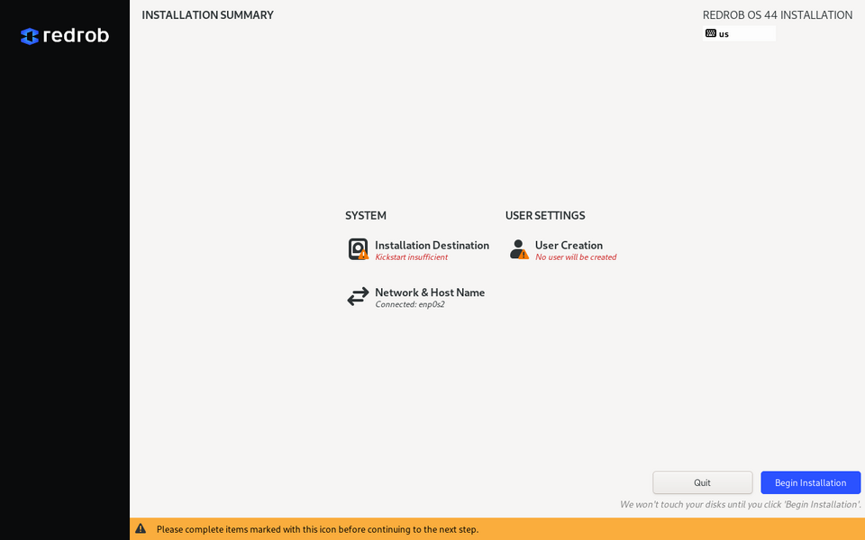

# Install Redrob OS

Redrob OS installs like Windows or macOS: download an installer, put it on a
USB stick, boot from it, and answer a few screens. The installer handles the
disk, dual boot with Windows, encryption and your user account.

Latest download: [redrob-os-linux-x86_64.iso](https://cdn.redrob.ai/os/latest/redrob-os-linux-x86_64.iso)
(one file). Older versions and the Raspberry Pi image: [Releases](https://github.com/redrob-labs/redrob-os/releases/latest).

| Target | File | Path |
|--------|------|------|
| PC / laptop (x86-64, UEFI) | `redrob-os-<version>-linux-x86_64.iso` | Installer USB (this page, sections 1–4) |
| Raspberry Pi 5 | `redrob-os-<version>-linux-aarch64.img.xz` | Raw image (section 6) |

Requirements: 64-bit UEFI PC, 4 GB RAM (8 GB recommended), 20 GB of free disk
(64 GB recommended), a 4 GB+ USB stick. Secure Boot can stay on.

한국어: [install.ko.md](./install.ko.md).

## 1. Download

Download the installer as one file from
`https://cdn.redrob.ai/os/latest/redrob-os-linux-x86_64.iso`, and its checksum
from the same address plus `.sha256`. A specific version lives at
`https://cdn.redrob.ai/os/<version>/redrob-os-<version>-linux-x86_64.iso`.

The same ISO is also on the GitHub release, but GitHub caps release files at
2 GiB, so there it comes as `.iso.part0`, `.iso.part1`, ... -- download every
part into one folder and join them:

```sh
# Linux / macOS
cat redrob-os-<version>-linux-x86_64.iso.part* > redrob-os-<version>-linux-x86_64.iso
```

```powershell
# Windows (PowerShell) -- list every part you downloaded
cmd /c copy /b redrob-os-<version>-linux-x86_64.iso.part0+redrob-os-<version>-linux-x86_64.iso.part1+redrob-os-<version>-linux-x86_64.iso.part2 redrob-os-<version>-linux-x86_64.iso
```

Checking the checksum is optional but quick:

```sh
sha256sum -c --ignore-missing SHA256SUMS
```

## 2. Write the installer to a USB stick

Any one of these works. The stick is erased.

- **[balenaEtcher](https://etcher.balena.io)** (Windows, macOS, Linux): *Flash from
  file* → pick the `.iso` → *Select target* → your stick → *Flash*.
- **[Rufus](https://rufus.ie)** (Windows): pick the stick and the `.iso`, keep
  *GPT* / *UEFI*, press *Start*. If Rufus asks, choose **DD image mode**.
- **[Ventoy](https://www.ventoy.net)**: install Ventoy on the stick once, then just
  copy the `.iso` onto it. Several installers can live on one stick.

Command line (Linux/macOS) — find the device with `lsblk` / `diskutil list`
first; `dd` has no undo:

```sh
sudo dd if=redrob-os-<version>-linux-x86_64.iso of=/dev/sdX bs=4M status=progress oflag=sync
```

## 3. Boot from the stick

Plug it in, power on, and open the boot menu (usually `F12`, `F2`, `Esc` or
`Del` while the maker's logo shows; on Windows you can also hold **Shift** while
clicking *Restart* → *Use a device*). Pick the USB stick.

A menu appears: **Install Redrob OS** (default) or **Test this media & install**.
The installer starts in about a minute.

<!-- TODO screenshot: boot menu -->

## 4. The installer

Each screen is one question. You can go back at any time; nothing is written to
the disk until you press **Begin Installation**.

1. **Welcome / language.** Pick your language (한국어 is here) and press
   *Continue*. The installer and the installed system use this language.
   <!-- TODO screenshot: language screen -->
2. **Installation Summary.** A hub with the remaining items. Anything marked
   with a warning icon still needs your input.

   
3. **Keyboard** and **Time & Date** are pre-filled from your language and
   network location. Check them, fix if needed.
4. **Network & Host Name.** Wired networks connect on their own; join Wi-Fi here
   if you want updates to start right after install. Leave the host name as it
   is — Redrob OS sets it to `redrob-<id>` on first boot.
5. **Installation Destination.** Tick the disk(s) to install on.
   - *Automatic* (pre-selected): uses the free space, or asks you to reclaim
     space on the next screen. Recommended.
   - *Encrypt my data*: full-disk encryption (LUKS2). You set a passphrase that
     is asked at every boot. Recommended for laptops; there is no recovery if
     you forget it.
   - *Custom*: hand partitioning, see *Reinstall keeping your files* below.
   <!-- TODO screenshot: destination screen -->
6. **User Creation.** Your name, user name and password. This account is an
   administrator (can install software and change settings). There is no
   separate `root` password.
7. **Begin Installation.** Takes 5–10 minutes. When done, the stick is ejected
   and the machine reboots into Redrob OS. Remove the stick if it asks.

What happens next is in [first-run.md](./first-run.md).

### Dual boot with Windows

Redrob OS can share a disk with Windows. Two ways to make room:

- **Shrink in Windows first (recommended).** In Windows open *Disk Management*
  (right-click Start → Disk Management), right-click the `C:` volume → *Shrink
  Volume…* and free at least 20 GB (64 GB is comfortable). Leave the space
  *unallocated*. Then boot the installer; *Automatic* partitioning uses the free
  space and leaves Windows untouched.
- **Let the installer reclaim space.** With *Automatic* selected, if there is
  not enough free space the installer shows *Reclaim Disk Space*: select the
  Windows partition → *Shrink* → drag the slider → *Reclaim space*. This resizes
  NTFS in place; Windows should be shut down normally beforehand (not
  hibernated, and *Fast Startup* turned off in Windows power options), or the
  partition is reported as in use.

After installing, the boot menu lists **Redrob OS** and **Windows**. Redrob OS
is the default; use the arrow keys to pick Windows. Windows' BitLocker may ask
for its recovery key once after the boot order changes — have it ready
([aka.ms/myrecoverykey](https://aka.ms/myrecoverykey)).

### Reinstall keeping your files

Redrob OS keeps the system under `/` and `/usr` (read-only, replaced on every
update) and everything that is yours under `/var` — your home folders are
`/var/home/<user>`, Flatpak apps are under `/var/lib/flatpak`. A reinstall that
keeps your files therefore means: **wipe `/`, keep `/var`**.

1. Installation Destination → tick the same disk → *Storage Configuration:
   Custom* → *Done*.
2. In *Manual Partitioning*, open the existing Redrob OS installation in the
   list on the left.
3. Select the `/` (root) entry → tick **Reformat** → mount point `/`.
4. Select `/boot` and `/boot/efi` → **Reformat** both.
5. Select `/var` → leave **Reformat unticked** → mount point `/var`. The
   installer warns that `/var` is on an existing file system; accept.
6. *Done* → *Accept Changes*.

Use the *same user name* in User Creation so the old home folder is picked up.
Your settings, documents, Launcher apps and Flatpaks survive. Anything the old
system had under `/etc` (e.g. Wi-Fi passwords) is reset.

If the previous install was encrypted, the installer asks for the passphrase
when you open it in *Manual Partitioning*.

## 5. After the first boot

- **Updates are automatic.** Redrob OS checks daily, downloads the next
  version in the background and switches to it at the next reboot. There is no
  update dialog and nothing to click; apps from the Redrob Launcher and Discover
  update the same way.
- **Nothing breaks on update.** Every update is a complete new system image.
  If a new version fails to boot, the machine goes back to the previous one on
  its own (health checks run at boot).
- **Pick the previous version by hand.** Hold **Shift** (or press `Esc`
  repeatedly) right after the maker's logo to show the boot menu, then choose
  the older entry. To stay on it: `sudo bootc rollback`.

## 6. Raspberry Pi 5 (raw image)

There is no installer on the Pi: you write a ready-made disk image and the
first boot asks for your account.

1. Download `redrob-os-<version>-linux-aarch64.img.xz` (and `SHA256SUMS`).
2. Write it to a microSD (A2-class, 32 GB+) or a USB/NVMe SSD with
   [Raspberry Pi Imager](https://www.raspberrypi.com/software/) (*Use custom* →
   pick the `.img.xz`) or balenaEtcher. No need to unpack the `.xz`.
3. Boot. The image grows to fill the card, then a **first-boot wizard** asks
   for language, keyboard, time zone and creates your user. After that the
   desktop starts and the [welcome dialog](./first-run.md) appears.

Headless Pi: the pairing code is also printed on the serial console (debug
UART, 115200) and sent over the agent's channels — see
[remote-access.md](./remote-access.md).

## Troubleshooting

Known, cosmetic: the installer's own text console (Ctrl+Alt+F2 while installing)
greets with "Fedora Linux 44" -- that is the installer environment
bootc-image-builder assembles from Fedora packages, not the system being
installed. The graphical installer and the installed system say Redrob OS.


- *The stick does not show in the boot menu.* Re-write it (Rufus: DD mode),
  and make sure UEFI boot is enabled; Legacy/CSM-only firmware is not supported.
- *Black screen after "Install Redrob OS".* Press `Esc` to see messages. On
  some laptops with hybrid graphics add `nomodeset` once: in the boot menu press
  `e`, append `nomodeset` to the `linux` line, `Ctrl-X`.
- *Windows not in the boot menu after install.* Use the firmware's own boot
  menu (`F12` etc.) and pick *Windows Boot Manager*; the Redrob OS menu entry
  for Windows is added when both systems are on the same disk and may take one
  update to appear.
